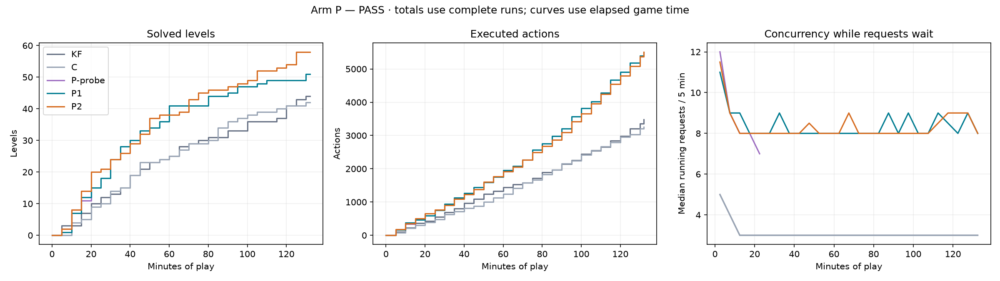

# Arm P full-pass readout: PASS

Local candidate: **P**. No competition submission is performed.

| Arm | Levels | Actions | Whole-run mean request latency (s) | Busy median running |
|---|---:|---:|---:|---:|
| KF | 44 | 3484 | 145.3 | 3.0 |
| C | 42 | 3262 | 146.9 | 3.0 |
| P-probe | 14 | 613 | 71.4 | 9.0 |
| P1 | 51 | 5495 | 97.9 | 8.0 |
| P2 | 58 | 5515 | 95.5 | 8.0 |

Rule: both full P passes valid; mean(P1,P2) >=51.5 levels against KF/C mean 43; pruning live and busy median running >=7 in each P pass.

Curves join post-action event scores to cumulative benchmark history times and sample at five-minute intervals plus the horizon. Final totals include every recorded action; a final action may finish just beyond the nominal horizon. Concurrency uses log time relative to benchmark start. Busy means running plus waiting >=20. The graph conditions on waiting >0.

Late individual request latency is unavailable: frozen notebooks retain only final cumulative histograms. Per-game inter-action gaps in assessment.json are a different measure.

The comparison changes pruning and serving together. A null result does not isolate whether pruning lost capability or extra actions failed to help. Historical controls are not simultaneous randomized controls. The registered threshold is a decision rule, not a precisely calibrated significance test.

Games gaining levels: 15; losing: 3. Net mean level gain after removing the best game: +6.5. These are diagnostics, not new gates.

| Game | KF | C | P1 | P2 | Mean level gain | Mean action gain |
|---|---:|---:|---:|---:|---:|---:|
| ar25-0c556536 | 1 | 2 | 2 | 2 | +0.5 | -2.5 |
| bp35-0a0ad940 | 0 | 1 | 1 | 1 | +0.5 | +25.5 |
| cd82-fb555c5d | 2 | 2 | 2 | 2 | +0 | +55.5 |
| cn04-2fe56bfb | 1 | 0 | 1 | 2 | +1 | -36 |
| dc22-fdcac232 | 2 | 1 | 2 | 1 | +0 | +132.5 |
| ft09-0d8bbf25 | 4 | 4 | 4 | 6 | +1 | +152.5 |
| g50t-5849a774 | 0 | 0 | 1 | 1 | +1 | +114 |
| ka59-38d34dbb | 2 | 1 | 1 | 1 | -0.5 | +65 |
| lf52-271a04aa | 1 | 1 | 1 | 1 | +0 | +116.5 |
| lp85-305b61c3 | 5 | 4 | 6 | 6 | +1.5 | +56.5 |
| ls20-9607627b | 1 | 1 | 1 | 1 | +0 | +374 |
| m0r0-492f87ba | 2 | 0 | 1 | 2 | +0.5 | +24.5 |
| r11l-495a7899 | 2 | 1 | 1 | 2 | +0 | +6.5 |
| re86-8af5384d | 4 | 3 | 4 | 4 | +0.5 | +189.5 |
| s5i5-18d95033 | 1 | 2 | 2 | 2 | +0.5 | +36 |
| sb26-7fbdac44 | 1 | 1 | 4 | 8 | +5 | -18.5 |
| sc25-635fd71a | 2 | 3 | 3 | 2 | +0 | +18 |
| sk48-d8078629 | 0 | 0 | 1 | 1 | +1 | +163 |
| sp80-589a99af | 1 | 1 | 0 | 0 | -1 | +138.5 |
| su15-1944f8ab | 3 | 1 | 3 | 3 | +1 | +96 |
| tn36-ef4dde99 | 0 | 2 | 1 | 2 | +0.5 | +137.5 |
| tr87-cd924810 | 2 | 5 | 1 | 1 | -2.5 | +43.5 |
| tu93-0768757b | 2 | 3 | 3 | 3 | +0.5 | +46.5 |
| vc33-5430563c | 4 | 2 | 3 | 3 | +0 | +46 |
| wa30-ee6fef47 | 1 | 1 | 2 | 1 | +0.5 | +151.5 |

Operational checks:

- KF: interpretation issues=[]; teardown shutdown_ok=False. Teardown is reported separately from completed gameplay.
- C: interpretation issues=[]; teardown shutdown_ok=False. Teardown is reported separately from completed gameplay.
- P-probe: interpretation issues=[]; teardown shutdown_ok=False. Teardown is reported separately from completed gameplay.
- P1: interpretation issues=[]; teardown shutdown_ok=False. Teardown is reported separately from completed gameplay.
- P2: interpretation issues=[]; teardown shutdown_ok=False. Teardown is reported separately from completed gameplay.

Reproduce: `python3 analysis/arm-p-full-20260930/assess.py`. Raw source hashes, measurements, and all per-game clear times are in [assessment.json](assessment.json).
