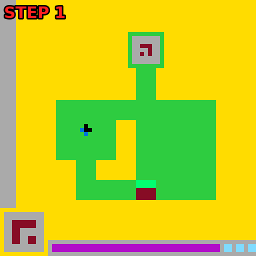

# Reki's second-place ARC-AGI-3 Solver: what the “labeled images” actually were

## Bottom line

The labels were **only temporal step numbers**: red text such as `STEP 17` drawn over the upper-left corner of each rendered board. They were not object IDs, coordinates, segmentation labels, predicted roles, action labels, or manually authored annotations.

The more consequential representation was a short **ordered frame sequence**. On a normal model call, Reki sent the last four observations as four separate 512×512 PNG images, oldest first, followed by a text prompt. Each image was a nearest-neighbor enlargement of the raw grid's final layer and carried its own `STEP N` label. The prompt explicitly said that the last image was current and that the red labels represented chronology rather than game UI.

That visual stream was only one part of the complete Solver. The model also received legal-action constraints, numeric transition summaries, exact-state failed actions, a compact persistent reflection memory, and an output contract for a 1–4-action plan. Deterministic code checked and executed the plan, measured actual state changes, repaired malformed JSON, supplied fallback actions, selected salient click targets, and remembered structurally inert click classes.

## Evidence and provenance

ARC Prize's official Milestone 1 announcement identifies **Reki** as second place and describes the submission as a locally served Gemma-4-31B “vision-LLM-as-policy” Solver using labeled recent frames, JSON actions, reflection memory, click saliency, and a dead-signature mechanism.[2]

The associated Kaggle competition is the official `ARC Prize 2026 - ARC-AGI-3` competition.[3]

The winning Kaggle notebook is `ruichardliu/milestone1-2nd-solution`.[1]
Its best-scoring public version is Version 5, with score **0.86**.[8]
I downloaded that Version 5 notebook directly from Kaggle's old-version page and download endpoint, and separately fetched the latest Version 7 source through Kaggle's public kernel API.[4][9]

Kaggle documents versioned kernel references in `owner/kernel/version` form.[7] Anonymous API attempts for this old version were denied, so the Version 5 `.ipynb` was obtained through Kaggle's public old-version UI rather than inferred from Version 7.

Verification of the artifacts:

- downloaded Version 5 notebook SHA-256: `c030cdb044675077d5a9c65274af7a5c00469c06cc682fa004d361f91fa61ea9`
- extracted Version 5 `my_agent.py` SHA-256: `b2a9461deef774213c32baf6752aca2d809ba18276e96859156d34114d77ca03`
- extracted Version 7 `my_agent.py` SHA-256: `b2a9461deef774213c32baf6752aca2d809ba18276e96859156d34114d77ca03`
- all 20 Version 5 and Version 7 notebook source cells compare equal; the notebook outputs differ
- the extracted agent compiles with `python3 -m py_compile`

Therefore, Version 7's visible source is an exact source-level copy of the 0.86 Version 5 Solver, not merely a later approximation. This is stronger evidence than relying on the blog summary alone.

## Exact labeled-image construction

### 1. Which observations were retained

After every environment step, `_observe_frame` appended an entry containing:

- `step = action_counter`
- state and levels completed
- the complete `latest_frame.frame`
- a frame hash and small frame signature

`MAX_FRAME_MEMORY = 11`. Normal action selection used `ACTION_CONTEXT_FRAMES = 4`, so `_build_context_images` selected the last four retained entries. A reflection call requested `REFLECTION_INTERVAL + 1 = 11` images instead.[9]

The entries were preserved in chronological order. They were **not** combined into a contact sheet or tiled composite.

### 2. Which grid was rendered

For each entry, `_frame_to_image` selected only:

```text
last_grid = frame_3d[-1]
```

Thus the image represented the final 2-D grid inside that observation. An absent frame became a 64×64 all-zero grid. Ragged rows were padded implicitly with color 0.[9]

Each cell value was converted to an integer, reduced modulo the 16-entry ARC palette, and rendered as one RGB pixel. Invalid values became color 0. This produced a width×height raster—normally 64×64—with no coordinate rulers, grid lines, object boxes, region IDs, captions, crop, or added padding.

### 3. Enlargement

The raster was enlarged by `FRAME_IMAGE_SCALE = 8` using Pillow's nearest-neighbor resampling. A 64×64 board therefore became **512×512**, with each source cell represented by an 8×8 constant-color block. Nearest-neighbor enlargement preserved hard cell boundaries; it did not interpolate or smooth the board.[9]

### 4. The exact label

For an entry whose recorded step was `N`, `_build_context_images` called:

```text
_label_image(_frame_to_image(frame), f"STEP {N}")
```

The label renderer used:

| Property | Exact value |
|---|---|
| String | `STEP {step}` |
| Position | `(8, 6)` in the enlarged image's pixel coordinates |
| Preferred font | `DejaVuSans-Bold.ttf`, size 32 |
| Fallback font | Pillow default, requested at size 32 where supported |
| Fill | `(255, 32, 32)`—bright red |
| Stroke | 3 pixels |
| Stroke color | `(0, 0, 0)`—black |

The label was drawn directly **over the board**, not in a margin. It could obscure a small area near the upper-left corner. No other visual annotation was added.[9]



The image above is a local reconstruction, not a frame from Reki's private competition run. It applies the Version 5 rendering constants and label code to this repository's frozen LS20 grid so the representation can be inspected directly.

### 5. How the images entered Gemma

Each labeled Pillow image was encoded independently as PNG, then Base64-wrapped as an OpenAI-compatible `image_url` data URL. The multimodal user message contained:

1. oldest labeled observation image
2. next labeled observation image
3. next labeled observation image
4. current labeled observation image
5. one text prompt

The prompt stated:

- the images are chronological;
- the last image is current;
- the red `STEP` labels are chronology, not game UI;
- numeric transitions should be trusted over visual guesses.

For reflection, the same machinery sent up to 11 chronological labeled images instead of four.[9]

## What the label encoded—and what it did not

### Directly established by code

The label encoded exactly one value: **the Solver's environment action counter for that observation**.

It provided an explicit ordering token when multiple separate images were sent. It did not itself describe what changed between frames. The model had to infer visual change, while deterministic code separately supplied numeric transition records.

### Claims the implementation does not support

The label was **not**:

- an object class or object identity;
- a coordinate system or ruler;
- a segmentation mask;
- an action name such as `up` or `click`;
- an indication of “before” versus “after” beyond step ordering;
- a learned prediction;
- a manually curated semantic annotation;
- a composite-image panel title.

The official phrase “labeled images” makes this feature sound more semantically elaborate than the implementation was. A more precise description is **separate chronological board renders with overlaid step-number timestamps**.

## The complete Solver around those images

### Action-model request

The action prompt also included:

- the exact legal semantic actions in the current state;
- per-action JSON format instructions, including click coordinates in `[0, 63]`;
- actions already proven ineffective in the exact current state;
- a persistent reflection memory;
- the last four compact numeric transitions;
- an instruction to return one JSON object with `board_change_assessment`, `plan_summary`, and one to four actions.

The Gemma component was served locally through vLLM's OpenAI-compatible API. Defaults included Gemma-4-31B-IT, 32,768 model context, JSON-object response mode, 1,024 output tokens, temperature 0.2, and action thinking **off**.[9] The model therefore acted as one Game Judgment component inside a larger Solver; it was not the complete agent.

### One model call could drive several environment steps

The official write-up says “one JSON action per step,” but the implementation is more specific: the model returned one JSON **object** holding a queue of 1–4 actions. After the first action, subsequent queued actions could be executed on later environment steps without another model call.

The Solver still observed every intermediate frame. Before executing a queued action, it checked whether that action remained legal and whether it had already failed in the exact state. If not, it dequeued it. This reduced inference calls but also meant later actions in a plan were not freshly replanned from the newest image unless the queue was cleared.[9]

### Numeric transition evidence

After observing the next frame, deterministic code linked it to the previous action and recorded:

- number of changed grid cells;
- level delta;
- whether the state hash changed;
- whether the state had appeared before;
- the action and click coordinates;
- before/after frame signatures.

Frame comparison ignored a configurable three-cell outer border. This numeric record, not the red label, populated “Recent transitions” and the reflection input.[9]

### Reflection memory

Every ten completed transitions, the Solver:

1. discarded any remaining queued plan;
2. sent the last 10 transition records plus up to 11 labeled images;
3. asked Gemma, with thinking disabled, to rewrite a compact Markdown memory;
4. required headings `Rules`, `Goal`, `Progress`, and `Avoid`;
5. capped the memory at 1,800 characters;
6. atomically persisted it per game and reloaded it when available.

This was an explicit causal-learning loop: visual chronology plus deterministic action/outcome summaries were periodically compressed into a reusable game model.[9]

### JSON guards and fallbacks

The normal request used JSON-object response mode. The parser searched the response for JSON objects, preferred a payload containing `actions` or `action`, normalized aliases, rejected unknown or unavailable actions, clamped click coordinates, and excluded actions already known ineffective. If parsing failed, the Solver issued a separate non-thinking JSON-repair request using the same images.[9]

On model failure or an unusable plan, a deterministic fallback cycled through legal actions. For click actions, the fallback did not simply sample a random pixel.

### Salient-click heuristic

The NumPy-only click picker:

1. treated the most frequent color as background;
2. found 4-connected, single-color non-background components;
3. described each component by color, size, rectangle status, and number of structurally identical twins;
4. scored components equally by color rarity and a hand-built small-size score;
5. selected a central component pixel from the highest-ranked usable component.

This is where semantic-looking structure entered the Solver—but it was not painted into the model image. It only selected fallback click coordinates and supported dead-signature bookkeeping.[9]

### Dead-signature

For a clicked component, the Solver computed:

```text
(color, component_size, is_rectangle, twin_count)
```

If that structural class produced no changed cells and no level progress twice by default, it became “dead” for the rest of the level, unless an earlier click on the class had produced an effect. Dead classes were skipped by the salient fallback picker and, under the default veto, could also invalidate a model-proposed click. All of this reset at a new level.[9]

## What was inherited versus changed

The official ARC Prize post says Reki built on the official GPT-OSS-120B template and swapped in Gemma-4-31B.[2] The official template remains public on Kaggle.[5] Direct source comparison shows that “model swap” is an incomplete engineering description:

- the template supplied the competition harness, local-model serving pattern, action interface, timing/safety structure, and general JSON-guided approach;
- Reki added or substantially rewrote the multimodal chronological-image path, step labels, richer action schema, multi-action queue, transition bookkeeping, reflection memory, JSON repair, exact-state failure tracking, click saliency, and dead-signature machinery.[4][6]

The labeled images are therefore part of Reki's Solver adaptation, not a pre-existing feature that came automatically with Gemma or the starter template.

## What is measured, inferred, and still unknown

### Measured or directly documented

- Reki placed second.[2]
- Version 5 scored 0.86 on Kaggle.[8]
- Version 5 and current Version 7 contain identical source cells.
- The exact image pipeline and labels above follow directly from the downloaded source.
- The Solver comments identify a `0.64 base` recovered by disabling `GEMMA_SALIENT_CLICK` and `GEMMA_DEADSIG`.

### Reasonable interpretation

The step label's likely function was to remove ambiguity about temporal order when Gemma received several visually similar image inputs. The larger gain plausibly came from the **combination** of temporal visual context, exact action/outcome summaries, persistent reflection, constrained action execution, and click exploration—not from drawing red text by itself.

### Not established

No published controlled table was found isolating:

- four images versus one;
- step labels versus unlabeled chronological images;
- images versus numeric transition summaries;
- reflection memory versus no reflection;
- salient clicks versus dead-signature separately;
- any individual feature's contribution to the 0.86 score.

The source comment about a 0.64 base is useful author evidence, but it does not uniquely identify which component caused the observed score difference. Nor do end-to-end scores reveal how Gemma internally represented the labels.

## Implication for our Solver

The useful lesson is **not “add object labels.”** Reki did not add them. The transferable design is:

1. preserve a short sequence of exact chronological observations;
2. make ordering unambiguous;
3. compute action/outcome deltas outside the model;
4. feed those deltas back as compact evidence;
5. periodically consolidate rules and goals;
6. keep deterministic legal-action and exploration guards around model judgment.

The cheapest probe to isolate the visual-label contribution in our current Solver is a fixed-state, fixed-model contrast:

1. one current image;
2. four chronological images with no labels;
3. the same four images with Reki's exact `STEP N` overlays;
4. the same four images plus deterministic numeric transition summaries.

That sequence separates **temporal evidence**, **ordering labels**, and **explicit state-delta evidence** instead of treating “labeled images” as one indivisible technique.

## Sources

[1] https://www.kaggle.com/code/ruichardliu/milestone1-2nd-solution — Milestone1-2nd-solution — Reki Kaggle notebook
[2] https://arcprize.org/blog/arc-prize-2026-milestone-1 — ARC Prize 2026: ARC-AGI-3 Milestone Prize #1
[3] https://www.kaggle.com/competitions/arc-prize-2026-arc-agi-3 — ARC Prize 2026 - ARC-AGI-3 competition
[4] https://www.kaggle.com/api/v1/kernels/pull/ruichardliu/milestone1-2nd-solution — Kaggle API — Reki notebook v7 source
[5] https://www.kaggle.com/code/gregkamradt/arc-agi-3-gpt-oss-120b — Official ARC Prize GPT-OSS-120B template
[6] https://www.kaggle.com/api/v1/kernels/pull/gregkamradt/arc-agi-3-gpt-oss-120b — Kaggle API — official GPT-OSS-120B template source
[7] https://github.com/Kaggle/kaggle-cli/blob/main/docs/kernels.md — Kaggle CLI kernel version documentation
[8] https://www.kaggle.com/code/ruichardliu/milestone1-2nd-solution?scriptVersionId=331404258 — Reki notebook — best-scoring Version 5 (0.86)
[9] https://www.kaggle.com/kernels/scriptcontent/331404258/download — Kaggle Version 5 notebook download
